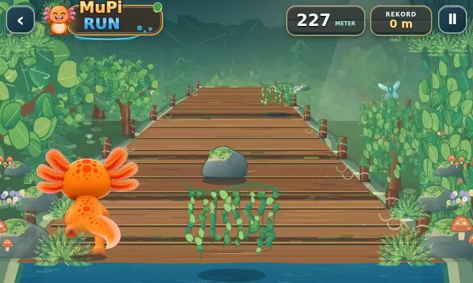
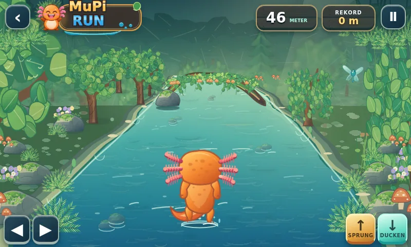
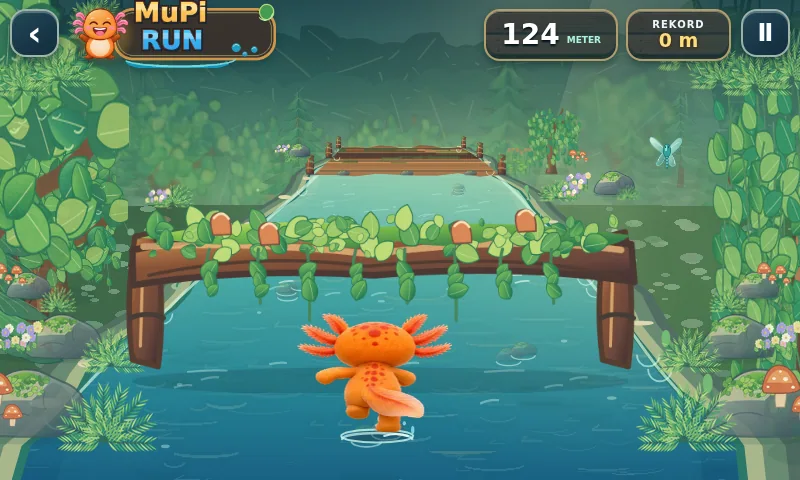
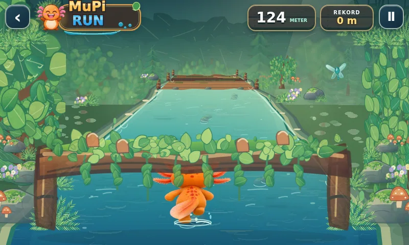
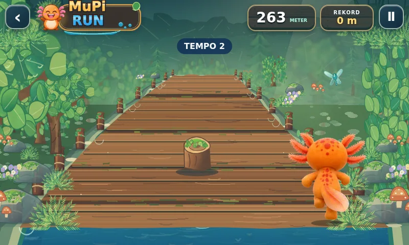
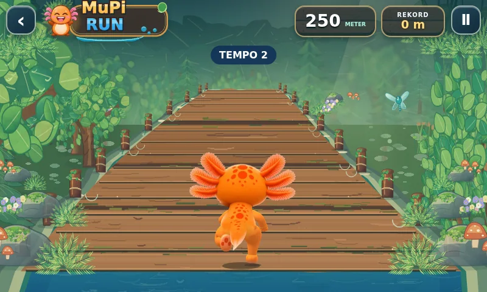
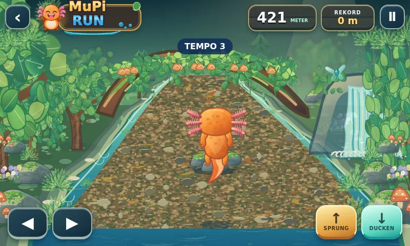
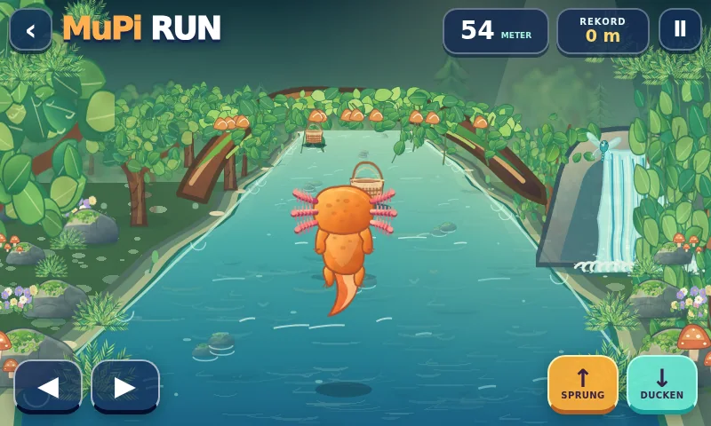
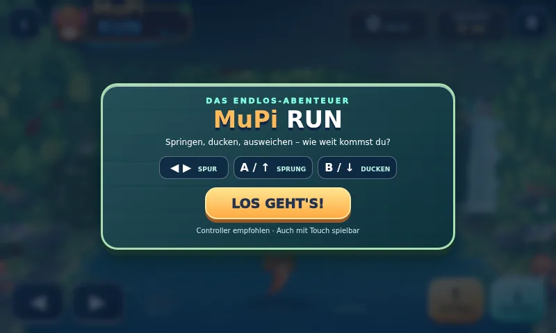

# MuPi Run – spielbarer Wald-/Brücken-Runner (0.6.0)

Eigenständige, vollständig offline spielbare MuPiBox-NG-Community-App für **800 × 480 Pixel** (5 Zoll). MuPi läuft aus der **Rückansicht** durch ein flaches, sich windendes Wald-Flussbett: ein orangefarbenes Axolotl mit exakt **drei Kiemenästen links und drei rechts**, eigenem Schweif und Lauf-/Sprung-/Duckanimation. Es gibt keine Fremdspiele, gekauften Assets, CDN- oder Online-Abhängigkeiten.

## Screencast – durchgehender Lauf (36 Sekunden, MP4, 30 FPS)

[MuPi Run Screencast ansehen](mupi-run-screencast.mp4)



Die Aufnahme kommt **direkt aus Chromium mit dem laufenden Canvas-Spiel** (800 × 480, H.264, 30 FPS, ohne Ton). Es ist ein **vollständig durchgehender Lauf mit monotonem Meterstand ohne Szenensprünge** durch Flussbett, Holzsteg und Waldpfad. Ein automatischer Spieler drückt echte Tastaturaktionen für Spurwechsel, Sprung und Ducken; er ersetzt keine Kollisionsprüfung und überspringt keine Strecke. Die Datei ist **keine** Aufnahme von Testbox 83 und **kein** KI-Konzeptvideo.

Reproduzierbar aufnehmen (Chromium, Python-websockets, Pillow und ffmpeg):

```bash
python3 tools/record_mupi_run_screencast.py
```

Die MP4-Datei ist ausschließlich zur Dokumentation im Repository vorhanden. Sie wird **nicht** ins installierbare `.mupiapp`-Paket übernommen.

## Echte Community-App-Screenshots (800 × 480)

Die Aufnahmen liegen bewusst **direkt im Anwendungsverzeichnis**.

















Die Screenshots wurden aus dem **wirklich laufenden HTML-Canvas-Spiel** mit Chromium bei 800 × 480 aufgenommen, **nicht** aus Konzeptbildern. Ducken, Holzsteg und Waldpfad sind deterministische Vorschau-Szenen derselben Kollisions- und Render-Engine. Kein Hardwaretest auf Box 83.

## Grafiken

Die Illustrationen sind **eigenständige, freigestellte** PNG-Sprites (transparentes Alpha) und werden als perspektivisch skalierte einzelne Elemente in den Game-Canvas eingesetzt. Sie sind **keine einfachen Canvas-Kreise oder -Rechtecke**:

- **Original-MuPi-GIF als echte Laufanimation:** Das vom Nutzer bereitgestellte GIF liegt unverändert unter `source/mupi-run-reference.gif` (20 Frames, 280×280, transparent). `tools/import_mupi_run_gif.py` erzeugt daraus den transparenten, kompakten `art/mupi-running-atlas.webp` mit 5×4 Frames. Das Spiel zeichnet die **tatsächlichen GIF-Einzelbilder** nacheinander, bei steigender Geschwindigkeit etwas schneller. Die Bilder werden nicht neu interpretiert, künstlich gespiegelt oder durch geometrische Formen ersetzt. Bodenkontakt: Referenz-Fußhöhe Quellpixel y≈260 von 280. Die alte gezeichnete Figur bleibt nur als Fallback vorhanden, falls das neue Sprite nicht geladen werden kann.
- **Springen und Ducken:** Vorläufig werden die vorhandenen GIF-Posen angehoben beziehungsweise vertikal gestaucht. Dafür können später separate, zum gleichen MuPi-Modell passende Sprung-/Duck-Sprites eingebaut werden; eine eigenständige hochwertige Sprung-/Duck-Animation ist in 0.6.0 **noch nicht enthalten**.
- **Wald:** Laubbaum, Nadelbaum, Hängeweide, Farn, Schilf, Blumen, Pilze. Mehrschichtiger Waldhintergrund und Sonnenstrahlen.
- **Fluss:** Organisch gewundenes Wasserbett, transparente animierte Wassertextur mit Lichtbrechung, eingetauchte Steine, weiße Schaumlinien am Ufer und Sonnenreflexe.
- **Landschaft:** Illustrierter Baumstamm-Bogen, seitlicher Wasserfall, sonnige und schattige Waldschichten, Vordergrundkulisse und schwebende Libelle (keine zusätzlichen Kollisionen).
- **Hindernisse:** Moosfelsen, umgestürzter Baumstamm, Wurzel/Ast, Wasserplatsch, Stiefel, Baumstumpf, Schilf, Korb sowie tief hängende Äste/Ranken.

Die **SVG-Quellen der Einzelillustrationen** liegen neben ihren PNG-Pendants unter `art/`. Die zusätzlichen Atmosphären- und Oberflächentexturen werden im Python-Skript `tools/generate_mupi_run_atmosphere.py` generiert. Auf der Box werden die lokalen PNGs und der WebP-Animationsatlas geladen.

Alle Grafiken sind reproduzierbar: die Basisillustrationen aus `generate_mupi_run_sprites.py`, Atmosphäre aus `generate_mupi_run_atmosphere.py`, neue Wald-/Brückenobjekte aus `generate_mupi_run_zones.py`, UI-Logo aus `generate_mupi_run_logo.py` und das finale Cover/Icon aus `generate_mupi_run_cover.py`. Auf dem Entwicklungsrechner werden Pillow und `rsvg-convert` benötigt; auf der Box nur die gepackten lokalen PNGs sowie der WebP-Atlas. **Das alte nach vorne blickende MuPi-Bild ist nicht Bestandteil des Game-Pakets.**

## Spiel

- **Ziel:** Möglichst weit laufen; den Distanzrekord übertreffen.
- **Springen:** Baumstämme, Wurzeln, echte Steinhindernisse, große Sprungsteine, Wasserwirbel und verlorene Stiefel.
- **Ducken:** Tief hängende Äste, Ranken, Weidenzweige und **niedrige Brücken über alle drei Spuren**. Die Brücke ist ein echtes Kollisionselement – Ausweichen nach links/rechts reicht nicht; MuPi muss sich tatsächlich ducken.
- **Ausweichen:** Große Felsen, Baumstümpfe, Schilf und Körbe.
- **Brückendarstellung:** Eine echte Duck-Brücke besitzt getrennte Pfosten (`duck-bridge-rear.png`) und einen Querbalken (`duck-bridge-front.png`). Nur der Querbalken verdeckt MuPi kurz beim Durchlaufen und blendet hinter der Kollisionsstelle aus. Dekorative Brücken und Wasserfälle haben feste Weltpositionen, kommen näher und ziehen vorbei.
- **Spurwechsel-Kollision:** Der physikalische Kontakt wird während eines Spurwechsels anhand derselben interpolierten Position entschieden, die die sichtbare Spielfigur verwendet. Kein sofortiger unsichtbarer Spurtwechsel mehr.
- **Steuerung:** Touchbuttons sind kleiner, bei Verwendung von Controller oder Tastatur werden sie für freie Sicht ausgeblendet und bei Touchbedienung wieder eingeblendet.
- **Streckenwechsel:** In wiederkehrender Folge Flussbett (0–195 m), Holzsteg (195–360 m), trockener Waldpfad (360–530 m), danach Fluss und Wiederholung. Die Zonen werden pro Perspektivbereich anhand des tatsächlichen Laufwegs gerendert.
- **Lernkurve:** Erst einzelne Sprung- und Ausweichobjekte, danach eine garantierte Brücke zum Ducken; anschließend variable Hinderniskombinationen. Kindgerecht angepasste Aktionsfenster und geschwindigkeitsabhängige Hinweise vor Kollisionen.
- **Tempo:** Von 13 bis 29 Einheiten je Sekunde steigend; ab 125 Metern mehr Hinderniskombinationen.
- **Fairness:** Höchstens zwei blockierte Spuren je Welle. Mindestens eine freie Spur bleibt vorhanden.
- **Offline-Rekord:** Gespeichert als `bestMeters` im MuPiBox-Plugin-Speicher und über Updates beibehalten.
- **Sprachen:** Deutsch, Englisch, Französisch, Spanisch, Italienisch, Niederländisch und Schwedisch (Box-Sprache).

## Steuerung

| Aktion | Controller | Tastatur | Touch |
| --- | --- | --- | --- |
| Spurwechsel | Steuerkreuz links/rechts | ← / → oder A / D | Pfeiltasten oder links/rechts wischen |
| Springen | A / X / ↑ | ↑ / W / Leertaste | Gelber Button oder nach oben wischen |
| Ducken | B / Y / ↓ | ↓ / S | Türkiser Button oder nach unten wischen |
| Pause/Weiter | START | P | Pausenknopf |
| Zurück zur MuPiBox | BACK / SELECT | Escape | Zurückpfeil oben links |
| Start/Neustart | A / START im Menü | Enter / Leertaste | Startknopf |

**Wichtig:** B dient in diesem Spiel dem Ducken. Verlassen mit BACK/SELECT beziehungsweise dem sichtbaren Zurückpfeil. Bei Verlust des App-Fokus wird der Lauf pausiert.

## Paket & Tests

Im Repository-Stamm:

```bash
python3 tools/generate_mupi_run_sprites.py
python3 tools/generate_mupi_run_atmosphere.py
python3 tools/generate_mupi_run_zones.py
python3 tools/generate_mupi_run_logo.py
python3 tools/import_mupi_run_gif.py
python3 tools/generate_mupi_run_cover.py
python3 tools/build_mupi_run.py
python3 tools/mupiapp.py validate dist/mupi-run.mupiapp
node --check examples/mupi-run/app.js
node --test tests/mupi_run.test.cjs tests/mupi_run_autopilot.test.cjs
python3 tests/mupi_run_sprite_test.py
python3 tests/mupi_run_gif_test.py
python3 tools/capture_mupi_run_screenshots.py
python3 tools/record_mupi_run_screencast.py
```

Das Build-Skript packt die zur Laufzeit benötigten `art/*.png` und `art/*.webp` sowie HTML, CSS, JS, SDK, Manifest, Cover und Icon. **Keine SVG-Quelltexte oder Screenshots im .mupiapp-Paket.** Manuelle Installation über den Pluginmanager ist möglich. Der offizielle Katalog erfordert vor der Veröffentlichung ein geprüftes Release-Asset und dessen SHA-256.

## Technischer Status

- Automatisierte Spiellogiktests, JavaScript-Prüfung, Paketvalidierung und Chromium 800×480-Browser-Screenshots
- **Noch ausstehend:** Echter Controller-/Qt-Test auf Testbox 83; Freigabe für den offiziellen Community-App-Katalog

## Rechte und Datenschutz

Eigenständig entwickelter Spielcode und eigene Waldgrafiken unter der Repository-Lizenz MIT. Das integrierte originale MuPi-Lauf-GIF wurde vom Nutzer für diese Community-App zur Verfügung gestellt; die Rechte an dieser Charaktergrafik werden dadurch nicht automatisch auf MIT umgestellt. Keine übernommenen kommerziellen Fremd-Assets. Die App fordert nur `controller` und `storage` an; kein Netzwerk, keine Werbung, keine Tracker, keine Online-Dienste.